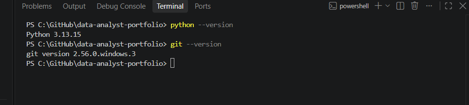

# Week 0 – Onboarding and Setup

## Context
Nädala 0 eesmärk:
- Iseseisev töö: Töökeskkonna paigaldamine 
- Muud ettevalmistused algavaks kursuseks

## What I did

### Individual setup
- Python 3.13 + pip - andmetöötlus - Installitud, versioon (3.13.15)
- Git -Versioonihaldus - Installitud 
- VS Code - Koodiredaktor - Installitud 
- VS Code laiendused SQLTools + SQLTools PostgreSQL - SQL-päringud otse VS Code’ist - Ühendus Supabase’iga loodud (Session pooler, SSL) 
- GitHub konto + GitHub Desktop - Portfoolio - Repo data-analyst-portfolio olemas, .gitignore ja hello_urbanstyle.sql on üleval
- Supabase - SQL-andmebaas (veebis) - Konto ja projekt „UrbanStyle” (eu-west-1) on loodud, testtabelid test_sales ja team_members on loodud
- Power BI Desktop - Visualiseerimine (Track A) - Installitud Microsoft Store’ist
- Claude Project „DACA andmeanalüütika kursus” - AI-tuutor kursuse failidega - Failid ja juhised on lisatud
- NotebookLM "DACA26et_SN"- RAG failidega on loodud

### Team work (Sales Analytics team)
- GitHub (avaliku)repo urbanstyle-sales-analytics loomine, README lisamine ja collaboratorite lisamine, kutsumine
- Team repository: https://github.com/15sigrid/urbanstyle-sales-analytics
- Details: [team/week0-team-summary.md](team/week0-team-summary.md)

## What I learned
- Kogu andmeanalüütiku töökeskkonna seadistamine (Python, Git, VS Code, Supabase, Power BI) ja VS Code'i ühendamine pilves asuva PostgreSQL andmebaasiga (SQLTools, Session pooler, SSL). Osa nendest tegevustest oli ununenud oskuste värskendamine (GitHub, VS Code)
- Git + GitHub töövoog: commit, push ja `.gitignore`, et paroolid ja `.env` failid ei satuks avalikku repo'sse. Oskuste värkendamine
- Markdowni alused: pealkirjad, lingid ja tabelid (tabel vajab päise all eraldusrida, muidu seda ei kuvata)
- Isikliku konto repos saavad collaborator'id kirjutamisõiguse, Admin-taset saab anda ainult organisatsiooni repos
- Meeskonna andmed peavad eri tööriistades ühtima: README, Supabase'i tabel ja Team Charter kasutavad samu nimesid ja rolle
- Giti repo ei tohiks asuda OneDrive'i kaustas, sest sünkroonimine võib Gitiga konflikti minna

